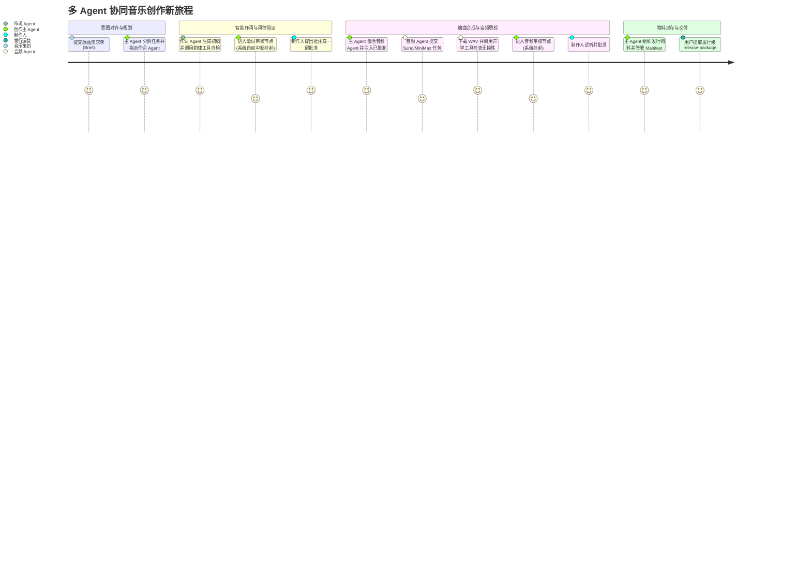

# 📄 产品需求文档 (PRD): 多 Agent 协同音乐创作与真实音频生成系统重构

> **版本**: v2.0.0 | **创建日期**: 2026-10-28 | **状态**: DRAFT  
> **关联技术蓝图**: [`docs/specs/multi_agent_music_refactor_blueprint.md`](file:///docs/specs/multi_agent_music_refactor_blueprint.md)

---

### 一、 业务背景、用户画像与痛点 (Background & Personas)

#### 1.1 业务背景与问题陈述
项目当前基于单体命令式脚本（`MasterAgent` 直接通过同步代码调用 `LyricsAgent` 与 `AudioAgent` 辅助方法），存在两大核心瓶颈：
1. **“伪 Multi-Agent” 架构**：缺乏真正的 Agent 自主推理、动态规划（Planning）、反思（Reflection）、工具调用（Tool Calling）以及基于状态图的动态多 Agent 协同体系；
2. **重度依赖 Mock 假数据**：音频生成主要依赖本地单调正弦波代码模拟（`MockMusicModel`），缺乏对接现代真实商用/开源 AI 音乐生成模型（如 Suno、MiniMax Music 等）的异步任务轮询、声学质检与自适应调优能力。

本次重构旨在引入业界工业级多 Agent 状态图框架（以 **LangGraph** 为核心，结合 LangChain 生态），将系统全面重构为真正的“**主控规划总监 + 专业作词 Agent + 编曲/音频工程 Agent**”多智能体协同系统，全面消除 Mock 依赖，建立可靠的生产级 AI 音乐创制工作台。

#### 1.2 目标用户画像 (Target Personas)
| 角色名称 (Persona) | 核心诉求 / 目标 (Goal) | 典型使用场景 (Context) | 当前痛点与摩擦 (Friction) |
| :--- | :--- | :--- | :--- |
| **音乐制作人 / A&R 总监** | 高效调度 AI 专家团队完成从灵感到母带级 WAV 音频的全闭环制作 | 输入商业 Brief 后，要求作词、编曲各司其职，在关键节点进行审美裁决 | 当前系统本质是生硬脚本，各环节无法像真人制作团队那样进行意图对齐与反馈迭代 |
| **词曲创作工程师** | 针对特定流派要求歌词具备严谨韵律、结构节奏与声调匹配 | 创作古风、流行或 Rap 歌曲，要求歌词支持字数节拍卡点与多方案比选 | 当前作词仅靠单一静态 Prompt，无法调用词律工具做自我纠错与韵脚分析 |
| **音频技术总监 / 运营方** | 获取包含完整声学参数、防伪校验、高保真真实音频的标准化发行物料包 | 审核发行物料包完备性与音频声学质量（非空、无爆音、LUFS 达标） | 当前生成的为玩具级合成单音频（Sine Wave），不能实际发行或试听 |

---

### 二、 核心价值主张与成功指标 (Value & Success Metrics)

#### 2.1 核心价值定位
以 **LangGraph 状态图引擎** 为基座，构筑具备**“自主意图规划、专业工具增强、真实音频驱动、代码级审核硬门禁”**的三 Agent 协同音乐创作工业流水线。

#### 2.2 量化成功度量体系 (Metrics & Targets)
| 衡量维度 | 核心指标 (Metric) | 当前基线 (Baseline) | 预期目标 (Target) | 观测窗口与统计口径 |
| :--- | :--- | :--- | :--- | :--- |
| **Agent 协同自治度** | 任务无需人工干预的自主工具调用与自纠比率 | 0% (纯静态命令式) | ≥ 85% (自主规划与词律/音频质检自愈) | 作词与音频子 Agent 的执行链路日志 |
| **真实音频产出率** | 真实商业/模型音频交付成功率 (非 Mock) | 0% (默认 Mock 占 100%) | ≥ 95% (真实 Suno/MiniMax API 生成有效 WAV) | 音频生成任务统计 |
| **审核防线坚固度** | 越权跳过审核流转率 (Prompt 注入防御) | 0% (已有硬门禁) | 保持 0% (通过 LangGraph `interrupt()` 硬隔离) | 全量渗透与越权测试用例 |
| **断点无损恢复率** | 复杂长任务中途异常后的原位恢复成功率 | 90% | 100% (LangGraph Checkpointer 原生持久化) | 任务崩溃重放测试 |

---

### 三、 功能范围、边界与 Non-Goals (Scope & Exclusions)

#### 3.1 核心交付功能清单 (In-Scope v2)
- **1. LangGraph 多 Agent 协同拓扑**：基于 StateGraph 构建包含 `SupervisorNode`、`LyricsAgentNode`、`AudioAgentNode`、`HITLApprovalNode` 的状态转移图；
- **2. 音乐创作主 Agent (Supervisor)**：具备全局 Brief 意图规划、任务契约分配、跨 Agent 协同调度与物料打包审计能力；
- **3. 专业作词子 Agent (Lyrics Agent)**：配备专业 Prompt 与词律检测工具（韵脚检测、节拍音节测算），具备修改反馈自纠能力；
- **4. 编曲/音频子 Agent (Audio Agent)**：具备根据词曲推导音乐工程参数能力，对接真实 Suno/MiniMax 异步生成 API，配备音频下载、格式转码与声学质检工具；
- **5. 确定性两阶段人机在环 (HITL Gate)**：使用 LangGraph 原生 `interrupt()` 挂起，由用户显式 CLI/Web 指令驱动推进；
- **6. 全局原子状态持久化**：支持 SQLite/文件 Checkpointer，实现长链路中断幂等原位唤醒；
- **7. 标准化发行物料包交付**：输出合规二进制 WAV、Manifest、歌词及完整审计溯源。

#### 3.2 明确排除项与重审条件 (Out-of-Scope / Non-Goals)
| 排除事项 (Non-Goal) | 排除原因与权衡考量 (Rationale) | 重审触发条件 (Revisit Condition) |
| :--- | :--- | :--- |
| **对接外部流媒体平台发布接口 (如 Spotify/网易云上传)** | 保持严格边界（R6 铁律），避免引入外部平台账号与上架风险 | 下游建立专门的发行中台且具备企业分发资质 |
| **纯自然语言弱控自由对话群聊** | 严禁采用 AutoGen 纯闲聊式自由 GroupChat，避免状态漂移与死循环 | 本项目核心为工业化确定性流水线，此项永不放开 |
| **客户端本地显卡大模型本地部署 (如 30GB AudioCraft weights)** | 降低开发者与部署机器硬件门槛，默认采用云端标准 API 方案 | 当业务明确要求离线私有化部署并配备专用 GPU 集群 |

---

### 四、 用户旅程与核心业务用例 (User Journey & User Stories)

#### 4.1 端到端用户旅程 (End-to-End Journey)

#### 4.2 核心用户故事与验收判据 (Given-When-Then)

- **Story 1: 多 Agent 状态图协同与歌词自检**
  - **As a** 制作人, **I want to** 作词 Agent 在生成歌词后自动调用韵律工具验证并修正押韵, **So that** 我审查的歌词已具备基本的文学与节奏规范。
  - **验收条件 (GWT)**:
    - `Given` 需求单指定为“押韵严格的古风七言”；
    - `When` 作词 Agent 节点执行；
    - `Then` 作词 Agent 自主调用 `rhyme_checker_tool`，发现不押韵句段自动触发反思重写，输出结构化 `Lyrics` 实体后挂起等待人工审核。

- **Story 2: 真实音频模型长任务异步调度与质检**
  - **As a** 制作人, **I want to** 音频 Agent 真实调用 Suno/MiniMax 生成真实音乐而非假正弦波, **So that** 交付的音频可以真正试听和用于商业预演。
  - **验收条件 (GWT)**:
    - `Given` 歌词已获人工批准（`lyrics_approved`）；
    - `When` 音频 Agent 启动任务；
    - `Then` 向真实 API 提交生成任务，自动以指数退避轮询直至完成，下载 WAV 后运行声学检查工具确认采样率 ≥ 44.1kHz、无削顶截断后交付试听。

---

### 五、 业务规则与可观测埋点 (Business Rules & Telemetry)

#### 5.1 核心业务数据埋点矩阵 (Telemetry Matrix)
| 埋点事件标识 (Event Key) | 触发时机与位置 | 核心上报参数 | 对应的北极星 / 业务 KPI |
| :--- | :--- | :--- | :--- |
| `agent_workflow_started` | 用户创建项目并启动图引擎 | `project_id`, `genre`, `target_duration` | 创制任务发起总量 |
| `agent_tool_invoked` | 子 Agent 触发工具调用 (词律/音频 API) | `agent_name`, `tool_name`, `duration_ms`, `success` | Agent 自治度与工具调用频率 |
| `hitl_gate_reached` | 流程行进至人工在环审核门禁 | `stage`, `version`, `waiting_time_s` | 人机协同响应时效 |
| `real_audio_synthesis_completed` | 真实音乐模型轮询完成并落盘 WAV | `provider`, `duration_s`, `file_size_bytes`, `sha256` | 真实音频产出率 (消除 Mock 指标) |
| `package_delivered` | 发行物料包构建完成并通过防篡改审计 | `project_id`, `state`, `missing_items_count` | 发行物料一次性合格率 |

---

### 六、 交付里程碑与发布计划 (Milestones & Release Plan)
| 阶段 | 交付核心价值 | 包含关键功能点 | 验收基准 (DoD) |
| :--- | :--- | :--- | :--- |
| **M1: 架构升级 (LangGraph 拓扑)** | 确立状态图、三 Agent 骨架与 HITL 中断 | 引入 `langgraph`, `langchain-core`，搭建 StateGraph 与 SQLite Checkpointer | 测试用例通过，原流程在 LangGraph 状态图上成功闭环 |
| **M2: 专业 Agent 工具赋能** | 作词子 Agent 与音频子 Agent 具备真实工具 | 挂载歌词韵律检测工具、真实 Suno/MiniMax API 轮询客户端、WAV 质检工具 | 淘汰正弦波 Mock，成功生成首支真实 Suno/MiniMax 音乐 |
| **M3: 生产加固与多端联调** | 全流程加固、Web 交互与断点续跑验证 | CLI 与 Web GUI 无缝适配 LangGraph 状态流，版本自增审计与发行物料严密对齐 | 全量自动化测试全绿，端到端 0 假数据实测通过 |
