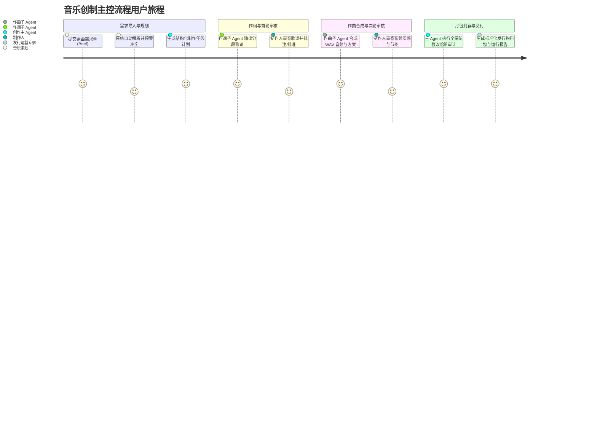

# 📄 产品需求文档 (PRD): 音乐创作主 Agent 编排与物料发行系统

> **版本**: v1.0.0 | **创建日期**: 2026-10-27 | **状态**: APPROVED  
> **关联技术蓝图**: [`docs/specs/music_creator_agent_blueprint.md`](file:///docs/specs/music_creator_agent_blueprint.md)

---

### 一、 业务背景、用户画像与痛点 (Background & Personas)

#### 1.1 业务背景与问题陈述
随着 AIGC 技术在音乐领域的飞速演进，AI 生成歌词、编曲与音频的技术日渐成熟。然而，当前数字音乐创制流程面临“散装生成易、合规发行难”的严重业务摩擦：
- **各环节割裂失控**：作词模型与音频模型各自为政，缺乏全局任务调度机制，无法自动保障情绪、流派与时长的上下文一致性；
- **黑盒冒进缺乏合规把控**：传统 AI 流程往往跳过人工确认直接合成，一旦生成侵权词曲或损坏音频，导致下游发行返工成本极高；
- **物料缺乏防伪校验**：交付下游发行平台时物料碎片化，缺失标准化的防伪清单（Manifest）与版权合规校验，经常因缺少封面、音频静音或参数缺失导致发行受阻。

本系统的目标是建立一套生产级、具备代码级硬门禁与人机协同（HITL, Human-in-the-Loop）的“音乐创作主 Agent 编排系统”，规范从歌曲需求单（Brief）到标准化发行物料包（Release Package）的全闭环流转。

#### 1.2 目标用户画像 (Target Personas)
| 角色名称 (Persona) | 核心诉求 / 目标 (Goal) | 典型使用场景 (Context) | 当前痛点与摩擦 (Friction) |
| :--- | :--- | :--- | :--- |
| **音乐策划 / 企划人 (A&R)** | 快速将商业需求（品牌、毕业季、游戏主题等）转译为完整词曲方案 | 日常根据 brief 批量规划歌曲，把控主题定位与情绪契合度 | 传统人工沟通耗时长达数天；直接用原生大模型生成效果松散且难保证时长、曲风等约束 |
| **词曲制作人 / 艺术总监** | 对 AI 生成的歌词分段与音频效果进行把关，提出专业修改意见 | 在歌词生成、音频合成两个关键节点进行人工审核与版本打回 | 缺乏统一审核看板与版本管理，打回重修时容易覆盖历史版本或造成逻辑紊乱 |
| **发行运营专家 / 版权合规官** | 获得完整、具备数字指纹且合规的发行物料包，对接流媒体渠道 | 在项目终态检查物料完备性、哈希一致性与版权免责凭证 | 收到的人工包经常缺封面、音轨哈希对不上或格式不合规，导致发行审核被拒 |

---

### 二、 核心价值主张与成功指标 (Value & Success Metrics)

#### 2.1 核心价值定位
为音乐企划与制作团队打造一套**“严密受控、人机协同、全量留痕、物料防伪”**的端到端音乐创作编排主控中枢，实现从需求单到合规发行物料包的分钟级标准化交付。

#### 2.2 量化成功度量体系 (Metrics & Targets)
| 衡量维度 | 核心指标 (Metric) | 当前基线 (Baseline) | 预期目标 (Target) | 观测窗口与统计口径 |
| :--- | :--- | :--- | :--- | :--- |
| **生产提效** | 歌曲方案初稿（词曲全套）流转耗时 | ≥ 48 小时 (传统人工作业) | ≤ 3 分钟 (自动化生成) | 系统从 Brief 解析到输出物料全流程 |
| **审核防线** | 未经人工审核的非法流转拦截率 | 60% (易漏审) | 100% 代码级硬拦截 | 歌词至作曲、音频至发行的每次跃迁 |
| **物料合格率** | 发行物料包首轮校验通过率 | 75% | ≥ 98% (零损坏、零哈希冲突) | 物料包 Manifest 与实际二进制校验 |
| **故障恢复** | 异常中断恢复成功率 | 20% (往往全流程推倒重来) | 100% 幂等恢复 (断点无损续跑) | 中途强退或异常后执行恢复命令 |

---

### 三、 功能范围、边界与 Non-Goals (Scope & Exclusions)

#### 3.1 核心交付功能清单 (In-Scope v1)
- **1. 需求单解析与异常冲突预警**：支持读取标准 Brief 需求单，自动识别数值/文本冲突、平台不匹配与关键物料缺失；
- **2. 结构化任务规划 (DeepSeek)**：主 Agent 自动解析 Brief 意图，生成包含风格、情绪、结构与节奏的结构化制作计划；
- **3. 智能作词子 Agent**：基于大模型按结构（主歌/副歌/桥段）生成多维歌词方案，输出严格规范；
- **4. 人机协同两阶段审核硬门禁**：
  - 阶段一：歌词人工审核（支持批准推进或打回修改）；
  - 阶段二：音频人工审核（支持批准推进或重新编排）；
- **5. 作曲与真实音频合成子 Agent**：输出结构化工程参数（BPM、Key、能量曲线）并合成标准 RIFF/WAVE PCM 真实音频；
- **6. 不可逆版本自增与历史隔离**：歌词与音频每次重修生成自增版本（v1 ➔ v2），物理隔离不覆盖历史已审核文件；
- **7. 发行物料包打包与完备性降级门禁**：自动组装标准 `release-package/` 目录，计算全量 SHA-256 哈希，缺失关键物料或哈希篡改时强制判定为 `package_needs_info`，完备时标记为 `package_ready`；
- **8. 原子断点存储与幂等恢复**：任何步骤中断后均可通过项目 ID 原位恢复执行（Resume）。

#### 3.2 明确排除项与重审条件 (Out-of-Scope / Non-Goals)
| 排除事项 (Non-Goal) | 排除原因与权衡考量 (Rationale) | 重审触发条件 (Revisit Condition) |
| :--- | :--- | :--- |
| **调用真实外部流媒体发行平台 API** | 本系统职责终点是交付标准化本地发行物料包；直接对接外部发行平台属于下游独立分发系统的职责，避免外部接口变动影响创作主控内核 | 下游分发服务完成微服务化封装并建立统一发行中间件标准 |
| **纯自然语言提示词驱动系统流转** | 严禁将状态转移判定交给大语言模型决定，防止 Prompt 注入攻击越权跳过审核 | 任何情况下均不重审此项；工程硬门禁为永久底线 |
| **无版权校验的在线商用音色采样下载** | 避免引入外部网络不确定性与潜在版权连带法律风险，聚焦于可信音频生成与本地合成 | 引入具备商业授权的本地音色库标准集成方案 |

---

### 四、 用户旅程与核心业务用例 (User Journey & User Stories)

#### 4.1 端到端用户旅程 (End-to-End Journey)

#### 4.2 核心用户故事与验收判据 (Given-When-Then)

- **Story 1: 需求单解析与冲突前置拦截**
  - **As a** 音乐策划, **I want to** 在导入 Brief 时获知所有字段冲突与物料缺失, **So that** 避免带着错误参数进入下游昂贵的音频生成环节。
  - **验收条件 (GWT)**:
    - `Given` 导入包含 `duration_seconds: 210` 与 `duration_text: "2分45秒"`（165秒）冲突的 Brief；
    - `When` 启动流程并解析需求单；
    - `Then` 系统高亮输出冲突警告，记录到异常字典中，并在任务计划中主动协调规整。

- **Story 2: 歌词审核硬门禁拦截**
  - **As a** 艺术总监, **I want to** 确保歌词在未获本人显式审批前绝不开始作曲, **So that** 杜绝未经审核的歌词浪费算力与合成时间。
  - **验收条件 (GWT)**:
    - `Given` 项目当前处于 `lyrics_ready` 状态；
    - `When` 有指令试图强行调用作曲/音频生成子 Agent；
    - `Then` 状态机代码级门禁抛出异常并强制阻断，状态维持在 `lyrics_ready`，直到收到显式人工批准指令。

- **Story 3: 发行物料包完备性与降级门禁**
  - **As a** 发行合规官, **I want to** 确保当物料包缺少封面或音轨哈希被篡改时系统拒绝标记为 `ready`, **So that** 避免残次物料被下游发行系统误采纳。
  - **验收条件 (GWT)**:
    - `Given` 歌曲已通过音频审核，但缺失封面图文件（或音频文件哈希与记录不匹配）；
    - `When` 主 Agent 触发最终物料包打包构建；
    - `Then` 物料包状态必须且只能标记为 `package_needs_info`，列出缺失清单，绝对禁止标记为 `package_ready`。

---

### 五、 业务规则、草稿保护与可观测埋点 (Business Rules & Telemetry)

#### 5.1 业务限制、草稿保护与局部容灾
- **版本隔离原则**：歌词与音频每次修改生成新版本（v1 ➔ v2 ➔ v3），旧版本只读归档，严禁物理覆盖已通过审核的历史版本。
- **草稿与进度保护**：每一个阶段性产物（歌词草稿、作曲参数、审核记录）立即原子持久化落盘，任何意外崩溃后均可通过 `resume` 原位继续。
- **降级容灾机制**：当大模型或外部服务出现 429 频控或网络抖动时，系统执行带抖动的指数退避重试（Backoff Retry）；多次失败后优雅挂起等待人工干预，不产生脏数据。

#### 5.2 核心业务数据埋点与北极星闭环矩阵 (Telemetry Matrix)

| 埋点事件标识 (Event Key) | 触发时机与位置 | 核心上报参数 | 对应的北极星 / 业务 KPI |
| :--- | :--- | :--- | :--- |
| `music_agent_brief_ingested` | 用户提交 Brief 并完成前置解析 | `project_id`, `anomaly_count`, `duration_s` | 需求前置合规率 / 冲突检测率 |
| `music_agent_stage_transition` | 状态机执行状态跃迁时 | `project_id`, `from_state`, `to_state`, `version` | 方案初稿流转耗时 / 各环节流转效率 |
| `music_agent_review_action` | 人工执行批准或打回操作时 | `project_id`, `stage`, `action(approve/reject)`, `feedback_length` | 审核防线有效性 / 方案返工率 |
| `music_agent_package_finalized`| 发行物料包打包完成并核验哈希 | `project_id`, `package_status(ready/needs_info)`, `missing_items` | 物料包首轮校验通过率 (≥ 98%) |
| `music_agent_resume_triggered` | 执行中断恢复时 | `project_id`, `resumed_from_state`, `success` | 故障恢复成功率 (100%) |

---

### 六、 交付里程碑与发布计划 (Milestones & Release Plan)

| 阶段 | 交付核心价值 | 包含关键功能点 | 预估周期 / 验收基准 (DoD) |
| :--- | :--- | :--- | :--- |
| **Milestone 1 (MVP)** | 核心链路单向闭环 | Brief 解析、DeepSeek 作词、Mock 作曲、基本状态机流转 | 自动化测试通过，正常样例可完整跑出物料包 |
| **Milestone 2 (Beta)** | 硬门禁与异常韧性加固 | 人工审核打回重试、版本隔离自增、Prompt 注入硬拦截、音频有效性校验 | 13 项异常与边界场景单测 100% 通过 |
| **Milestone 3 (GA)** | 生产级治理与物料包交付 | 完备性降级控制、断点恢复续跑、多格式运行报告、CLI 闭环体验 | 满足 `AGENTS.md` 全部 R1~R7 红线要求 |
