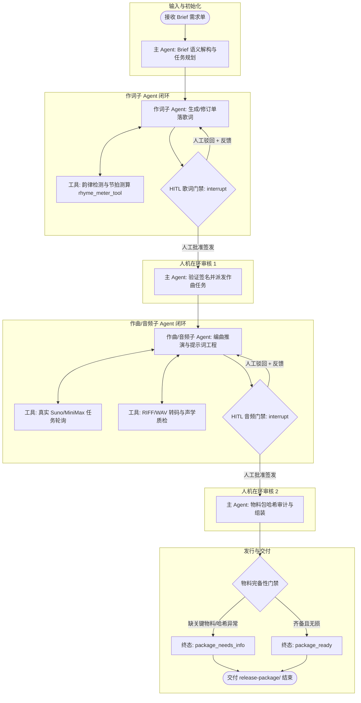
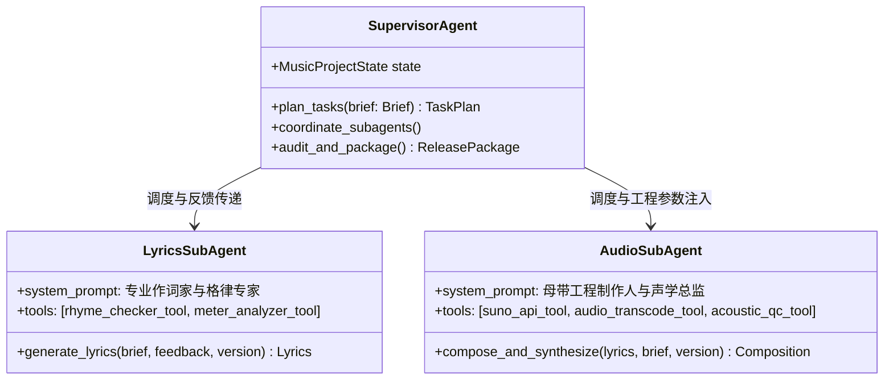
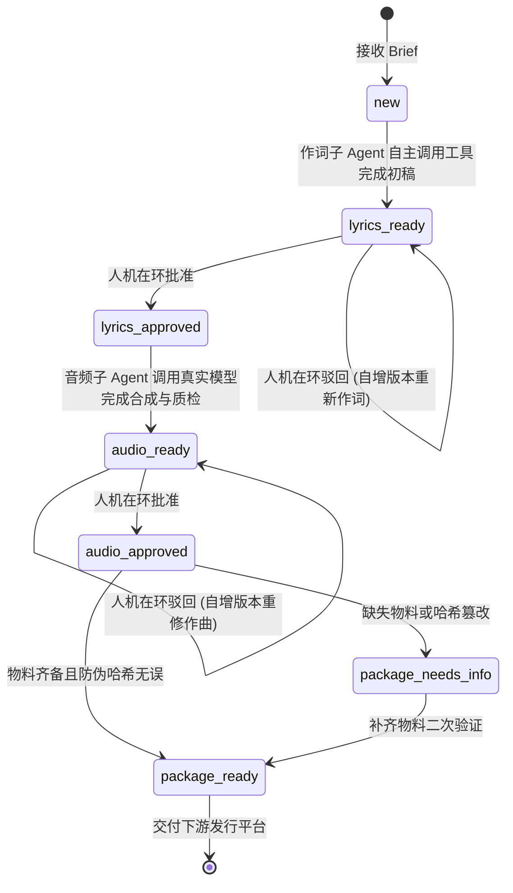
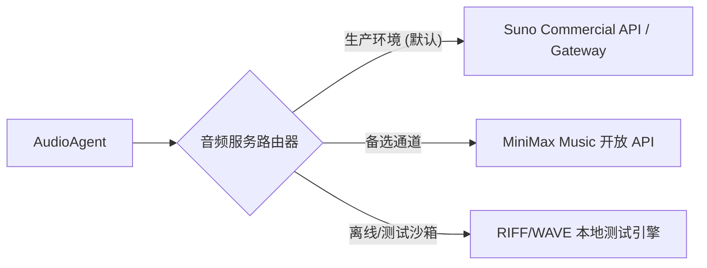

# 📐 功能设计蓝图: 多 Agent 协同音乐创作系统架构与 LangGraph 重构契约

> **版本**: v2.0.0 | **创建日期**: 2026-10-28 | **设计模式**: Mode A: 完备双产物 | **状态**: DRAFT  
> **关联 PRD**: [`docs/prd/multi_agent_music_refactor_prd.md`](file:///docs/prd/multi_agent_music_refactor_prd.md)

---

### 一、 系统核心业务流程与 Agent 拓扑 (System Flowchart & Topology)

本架构以 **LangGraph (StateGraph)** 为核心控制平面，将单体命令式脚本全面升级为分布式、具备 Tool Calling 与反思闭环的三 Agent 协同网络。

#### 1.1 LangGraph 协同状态图拓扑 (StateGraph Architecture)



---

### 二、 框架对比选型与三 Agent 职责契约 (Framework & Agent Contracts)

#### 2.1 多 Agent 框架对比选型矩阵
| 框架候选 | 状态图与 FSM 强控 | 人机在环中断 (HITL) | 契约确定性 (Pydantic) | 适用度与判定结论 |
| :--- | :---: | :---: | :---: | :--- |
| **LangGraph (推荐首选)** | ⭐️⭐️⭐️⭐️⭐️ (基于有向图与条件边) | ⭐️⭐️⭐️⭐️⭐️ (原生内置 `interrupt()` 与 Checkpointer 状态无损恢复) | ⭐️⭐️⭐️⭐️⭐️ (TypedDict / Pydantic State) | **最优解**：完美契合 `AGENTS.md` 的 R2 硬门禁与 R7 断点恢复铁律。 |
| **AutoGen (GroupChat)** | ⭐️⭐️ (侧重多角色自由涌现对话) | ⭐️⭐️ (依赖外部交互中断，难以保证步骤确定性) | ⭐️⭐️⭐️ (基于 JSON Schema) | **不推荐**：状态容易漂移，多轮闲聊易触发死循环与 Prompt 注入。 |
| **CrewAI** | ⭐️⭐️⭐️ (固定流水线 Sequential/Hierarchical) | ⭐️⭐️⭐️ (具备简单 human_input 钩子) | ⭐️⭐️⭐️⭐️ (集成 Pydantic) | **次选**：颗粒度较粗，底层对复杂状态回退与版本分支控制灵活性较弱。 |

#### 2.2 三 Agent 详细职责与工具挂载



1. **音乐创作主 Agent (Supervisor Agent)**:
   - **角色定位**: 唱片公司制作总监（Executive Producer）。
   - **核心职责**: 全局 Brief 意图解构、生成全局 TaskPlan、调度子 Agent、拦截越权流转、执行发行物料防篡改哈希审计。
2. **作词子 Agent (Lyrics Specialist Sub-Agent)**:
   - **角色定位**: 资深词作人（Lyricist & Topliner）。
   - **核心职责**: 针对 Brief 情绪、主题进行段落排布（Verse, Pre-Chorus, Chorus, Bridge），调用韵律与字数工具自主验证，支持接收审核反馈进行针对性重构与版本自增（v1 ➔ v2）。
3. **作曲/音频子 Agent (Audio & Composition Sub-Agent)**:
   - **角色定位**: 编曲人与母带混音总监（Arranger & Mixing Engineer）。
   - **核心职责**: 提取歌词韵律与情绪，计算 BPM、Key、配器风格；驱动真实 Suno/MiniMax 音乐模型异步长任务生成；下载并转码为符合母带标准的 44.1kHz 16-bit PCM RIFF/WAVE 格式；运行声学质检工具确保无静音、无爆音。

---

### 三、 异常补偿与清理清单 (Cleanup & Compensation)

| 失败步骤 (Failed Step) | 前置受影响资源 | 逆向清理/补偿动作 (Compensation Action) | 超时预算 (Timeout) | 补偿失败兜底 (Fallback) |
| :--- | :--- | :--- | :---: | :--- |
| **真实 Suno/MiniMax 任务超时/无响应** | 远端已提交的任务句柄 | 轮询重试至 300s，若超时自动注销轮询，释放线程池，并记录错误凭证 | 300.0s | 阻断流程跃迁，状态保持在 `lyrics_approved`，支持原位断点重试 |
| **音频下载不全或损坏 (非合法 WAV)** | 本地临时写入的不完整音轨文件 | 立即物理 `unlink` 删除坏损临时文件，绝不写入版本库与 Checkpoint | 5.0s | 触发备用通道重新拉取，或降级报错 |
| **人工驳回歌词或音频** | 当前就绪版本 (如 v1) | 保留历史版本物理文件（不可变隔离），版本号自增为 v2，将反馈写入审批流水 | 1.0s | 追加审计日志至 `approvals.json`，无缝流转回对应子 Agent |
| **物料打包缺少关键资产** | 组装好的中间目录 | 状态强制降级为 `package_needs_info`，在清单明确标注缺失字段 | 2.0s | 严禁签发 `package_ready`，阻止不合格资产外溢 |

---

### 四、 核心有限状态机与 LangGraph State 契约 (FSM & Graph Schema)

#### 4.1 全局状态图契约 (`MusicGraphState`)
```python
from typing import TypedDict, List, Optional, Dict, Any, Annotated
import operator
from pydantic import BaseModel, Field

class MusicGraphState(TypedDict):
    """LangGraph 全局状态模式，遵循 R1 契约规范。"""
    project_id: str
    state: str                          # new -> lyrics_ready -> lyrics_approved -> audio_ready -> audio_approved -> package_ready | package_needs_info
    brief: Dict[str, Any]               # Brief 数据字典
    task_plan: Optional[Dict[str, Any]]
    lyrics_version: str                 # "v1", "v2", ...
    audio_version: str                  # "v1", "v2", ...
    current_lyrics: Optional[Dict[str, Any]]
    current_composition: Optional[Dict[str, Any]]
    approval_history: Annotated[List[Dict[str, Any]], operator.add]
    last_feedback: Optional[str]
    package_metadata: Optional[Dict[str, Any]]
    errors: Annotated[List[str], operator.add]
```

#### 4.2 状态机跃迁矩阵


---

### 五、 真实音频生成适配器设计 (Eliminating Mock)

淘汰玩具级正弦波合成，建立标准三级音频供给矩阵：



#### 5.1 真实音乐服务契约 (`src/services/music_engine/`)
1. **任务提交与异步轮询机制**：
   - `submit_task(prompt, tags, duration, title)` ➔ 返回 `task_id`；
   - `poll_task(task_id, interval=5s, max_wait=300s)` ➔ 监听 `status == 'success'` 并获取 `audio_url`；
2. **音频母带级落地流水线**：
   - 流式下载音频字节流；
   - 调用 `ffmpeg` 或本地 `wave` 工具将音频转码为统一母带规范：**44.1kHz, 16-bit, 双声道 (Stereo), Linear PCM RIFF/WAVE**；
   - 提取时长、比特率、生成防伪 SHA-256，写入 `AudioMetadata`。

---

### 六、 前端 UI 与人机协同五态 (UI 5-State Contract)

| 状态 (State) | 触发条件 | 视觉表现与交互规范 | 用户心理与防错机制 |
| :--- | :--- | :--- | :--- |
| **Loading** | Agent 图推理中 / 真实音乐 API 轮询中 | 呈现多 Agent 协同脉冲动效 + 实时进度轮询日志（如 "Suno 生成中 45%..."） | 避免用户焦虑，明确展示后台并非卡死；禁用重复提交按钮 |
| **Empty** | 首次进入工作台未创建项目 | 提示导入 Brief 示例模板，支持一键填入流行/古风/电子范例 | 降低 0-1 使用门槛，直达创作入口 |
| **Error** | API 429、网络超时或质检不合格 | 错误卡片清晰显示异常归因（如“Suno 频控限流”），提供原位重试按钮 | **心血保护**：完整保留已编辑歌词与配置，绝不清空输入 |
| **Optimistic** | 制作人点击“批准进入下一阶段” | 界面即时呈现“已审批通过”徽章，后台提交 LangGraph 唤醒指令 | 消除等待顿挫感，失败时回滚并 Toast 提示 |
| **Normal** | 各阶段完成并挂起（Wait Review） | 显示歌词分段卡片、音频播放器波形图、物料下载入口与版本切换器 | 强化版本比对与审美决策支持 |
