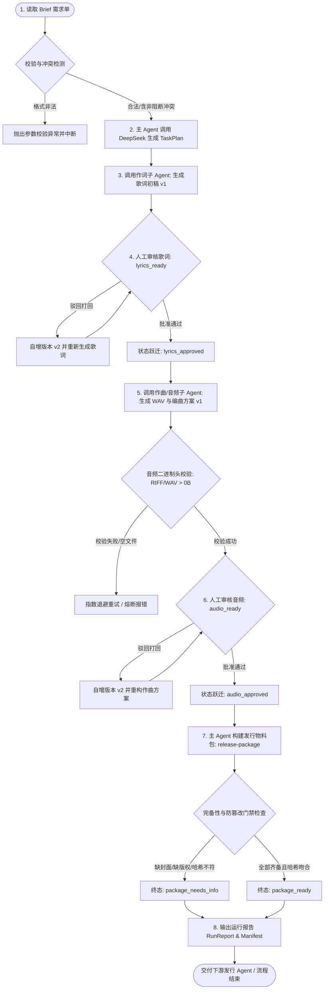
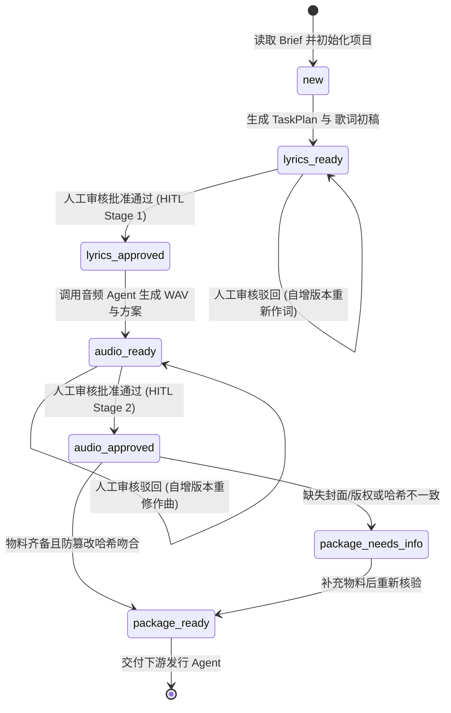

# 📐 功能设计蓝图: 音乐创作主 Agent 系统架构与技术契约

> **版本**: v1.0.0 | **创建日期**: 2026-10-27 | **设计模式**: Mode A: 完备双产物 | **状态**: APPROVED  
> **关联 PRD**: [`docs/prd/music_creator_agent_prd.md`](file:///docs/prd/music_creator_agent_prd.md)

---

### 一、 系统核心业务流程 (System Flowchart)



---

### 二、 异常补偿与清理清单 (Cleanup & Compensation)

| 失败步骤 (Failed Step) | 前置受影响资源 | 逆向清理/补偿动作 (Compensation Action) | 超时预算 (Timeout) | 补偿失败兜底 (Fallback) |
| :--- | :--- | :--- | :---: | :--- |
| **作词模型生成非法/截断 JSON** | 本地已创建的项目草稿目录 | 捕获 JSON 解析错误，最多执行 3 次自愈重试 Prompt；重试耗尽则状态保持 `new`，安全释放会话 | 15.0s | 记录错误日志，支持 CLI 原位重新触发，保护原始 brief |
| **音频模型 429 频控或超时** | 未完成的临时音频缓冲区 | 执行带抖动的指数退避（0.1s ➔ 0.2s ➔ 0.4s），最大重试 3 次；未完成音频临时句柄立即 close 并安全销毁 | 30.0s | 阻断流程推进，状态保持在 `lyrics_approved`，不产生残损文件 |
| **音频生成返回 0 字节或坏头** | 磁盘临时生成的损坏 `.wav` 文件 | 立即执行安全物理 unlink 清理，严禁持久化入版本库；抛出 `AudioGenerationError` | 2.0s | 阻断状态跃迁至 `audio_ready`，阻止用户接触损坏音频 |
| **人工审核驳回 (歌词或音频)** | 当前已通过/就绪的版本状态 | 保留旧版本物理文件（只读归档），版本计数器原子递增（如 v1 ➔ v2），状态回退至待修改阶段 | 500ms | 审核日志全量追加（Append-Only）至 `approvals.json` |
| **物料打包缺少关键资产 (如封面)** | 已合成的音频与歌词物料 | 不中断打包流程，但硬编码将状态降级标记为 `package_needs_info`，在 `manifest.json` 中明确列出缺失字段 | 1.0s | 严禁输出 `package_ready`，杜绝缺陷物料流入生产流媒体平台 |

---

### 三、 核心有限状态机与跃迁矩阵 (Finite State Machine)



#### 状态合法跃迁矩阵表 (Transition Matrix)
| 当前状态 (From) | 触发事件 / 方法 | 目标状态 (To) | 业务硬约束与代码门禁防御 | 幂等控制与审计留痕 |
| :--- | :--- | :--- | :--- | :--- |
| `new` | `start()` / `generate_lyrics()` | `lyrics_ready` | 必须通过 Brief Schema 校验；生成结构化计划 | 生成 v1 歌词，原子写入 `checkpoint.json` |
| `lyrics_ready` | `approve_stage(approved=False)` | `lyrics_ready` | 必须附带人工打回 feedback；版本自增 (如 v1 ➔ v2) | 审核日志写入 `approvals.json`，保留历史版本 |
| `lyrics_ready` | `approve_stage(approved=True)` | `lyrics_approved` | 审核人签名与时间戳留痕 | 满足进入音频阶段的前提条件 |
| `lyrics_approved`| `generate_audio()` | `audio_ready` | **硬门禁**：必须前置满足 `lyrics_approved` | 音频头合法性与时长校验，生成 v1 音频 |
| `audio_ready` | `approve_stage(approved=False)` | `audio_ready` | 附带打回意见；版本自增 (如 v1 ➔ v2) | 审核日志留痕，保护历史音频文件 |
| `audio_ready` | `approve_stage(approved=True)` | `audio_approved` | 必须显式 CLI 人工调用批准 | 满足生成发行物料包的前提条件 |
| `audio_approved`| `build_release_package()` | `package_ready` | **硬门禁**：所有物料齐全且 SHA-256 哈希 100% 匹配 | 生成规范 `manifest.json` 与 `release-package/` |
| `audio_approved`| `build_release_package()` | `package_needs_info` | 缺封面/缺版权/缺音频或哈希篡改时**强制降级** | `manifest.json` 标记状态与缺失详情 |

---

### 四、 聚合根、数据字典与存储设计 (Domain Schema & Storage)

#### 4.1 领域聚合根与存储边界 (Aggregate Root)
- **核心聚合根**: `ProjectCheckpoint`（管理整个歌曲项目的全局状态机跃迁、版本元数据与审计记录）；
- **存储拓扑**:
  ```text
  storage/projects/{project_id}/
    ├── brief.json                 # 原始与归一化需求单
    ├── plan.json                  # DeepSeek 任务结构化计划
    ├── lyrics_v1.json / v2.json   # 歌词不可逆历史版本库
    ├── composition_v1.json        # 作曲编曲方案版本库
    ├── audio_v1.wav / v2.wav      # 真实 RIFF/WAVE 二进制音轨
    ├── approvals.json             # 人工审核记录审计账本 (Append-Only)
    └── checkpoint.json            # 全局原子状态快照 (含防破坏临时替换)
  ```

#### 4.2 核心数据模型契约 (Pydantic / TypeScript 对齐)

```typescript
// 1. 歌曲需求单 Brief 契约
export interface Brief {
  project_id: string;               // 项目唯一标识符
  theme: string;                    // 歌曲主题/故事
  genre: string;                    // 音乐流派 (如: 流行摇滚, 国风电子)
  mood: string;                     // 情绪基调
  duration_seconds: number;         // 目标时长 (秒, > 0)
  duration_text?: string;           // 文本展示时长 (如: "3分30秒")
  audience?: string;                // 目标受众群体
  platform: string[];               // 目标发行平台列表
  primary_platform?: string;        // 核心主打平台
  references: string[];             // 参考曲风或意象
  constraints: string[];            // 创作约束条件 (如: 中文歌词, 原创)
  lyrics_language: string;          // 歌词语言 (默认: 中文)
  allow_sampling: boolean;          // 是否允许采样 (默认: false)
  cover_placeholder_path?: string;  // 封面占位图本地路径
}

// 2. 歌词段落与歌词模型契约
export interface LyricSection {
  section_type: 'intro' | 'verse' | 'chorus' | 'bridge' | 'outro';
  lines: string[];
  rhyme_scheme?: string;
  energy_level: 'low' | 'medium' | 'high';
}

export interface Lyrics {
  title: string;
  theme: string;
  genre: string;
  sections: LyricSection[];
  version: string;                  // e.g. "v1", "v2"
  raw_response_summary?: string;
}

// 3. 真实音频元数据契约
export interface AudioMetadata {
  file_path: string;
  format: 'WAV';                    // 严格标准 RIFF/WAVE
  sample_rate: number;              // 44100 Hz
  channels: number;                 // 2 (立体声)
  bits_per_sample: number;          // 16 bit
  duration_seconds: number;
  sha256_hash: string;              // 二进制哈希指纹
}

// 4. 发行物料包 Manifest 契约
export interface Manifest {
  project_id: string;
  title: string;
  artist_or_project: string;
  package_version: string;
  package_status: 'ready' | 'needs_info';
  missing_elements: string[];
  materials: {
    lyrics: { path: string; sha256: string; version: string };
    composition: { path: string; sha256: string; version: string };
    audio: { path: string; sha256: string; duration_seconds: number; sample_rate: number };
    cover: { path: string; sha256: string };
  };
  copyright_statement: string;
  approvals_summary: Array<{ stage: string; reviewer: string; approved: boolean; timestamp: string }>;
  created_at: string;
}
```

---

### 五、 核心 Agent 体系与交互职责 (Agent System Architecture)

```mermaid
graph TD
    User([CLI / 人工制作人]) <--> MasterAgent[主 Agent (Master Orchestrator)]
    
    subgraph 子 Agent 集群
      MasterAgent -->|调用规划 & Prompt 约束| LyricsAgent[作词子 Agent]
      LyricsAgent -->|DeepSeek API / Mock 兜底| LLMService[(LLM 引擎)]
      LyricsAgent -->|分段歌词 & JSON Schema 校验| MasterAgent
      
      MasterAgent -->|歌词 & 参数流转| AudioAgent[作曲/音频子 Agent]
      AudioAgent -->|PCM 合成 & 真实 WAV 编码| WaveEngine[(原生 Wave 引擎)]
      AudioAgent -->|WAV 音轨 & 编曲工程参数| MasterAgent
    end
    
    subgraph 基础设施与安全防御
      MasterAgent --> CheckpointMgr[原子持久化引擎]
      MasterAgent --> SecurityGate[Prompt 注入防御与硬状态机]
      MasterAgent --> Packager[物料打包器与哈希校验]
    end
```

#### 各 Agent 职责定位与输入输出规范
1. **音乐创作主 Agent (Master Orchestrator)**:
   - **职责**：全局总控、需求单加载、异常冲突前置拦截、两阶段人工审核硬门禁、不可逆版本递增、原子检查点写入、最终物料封包与全量 SHA-256 审计。
   - **防御机制**：不依赖任何大模型的意图识别来变更系统状态；严格由本地 Python 代码控制流决定。
2. **作词子 Agent (Lyrics Agent)**:
   - **输入**：规范 Brief 字段（主题、情绪、流派、时长、受众、主平台）。
   - **输出**：严格结构化歌词（歌名、Verse/Chorus/Bridge 分段、情绪能量标签、版本号）。
   - **容错**：内置 JSON 修复与 Schema 验证；打回时接收人工意见重修。
3. **作曲/音频子 Agent (Audio Agent)**:
   - **输入**：已审核通过的歌词、Brief 音乐参数（风格、节奏、时长）。
   - **输出**：合法 RIFF/WAVE PCM 二进制立体声音频文件（非0字节、具备标准44字节头）、BPM、调性 Key、编曲音轨说明、SHA-256 哈希。
   - **韧性**：网络抖动指数退避、429 频控自愈、损坏文件即时销毁。

---

### 六、 框架与技术选型决策 (Tech Stack & Architectural Rationale)

| 技术/库组件 | 选型决定 | 核心技术考量与选型理由 | 被否决方案及否决原因 |
| :--- | :--- | :--- | :--- |
| **基础语言环境** | **Python 3.9+** | 跨平台兼容性极佳，拥有丰富的 AI/LLM 生态与原生二进制流处理支持。 | Node.js / Go（生态在音频与大模型科研工具链契合度不如 Python 标准） |
| **数据契约单一起源** | **Pydantic v2** | 编译期强类型验证、极速 Rust 核心校验性能、无缝导出 OpenAPI/JSON Schema，实现业务字段零臆造。 | 原生 Dict / Dataclasses（弱类型、缺乏深层嵌套校验与错误定位能力） |
| **CLI 交互框架** | **Click 8.0+** | 优雅的装饰器设计、强类型参数校验、支持二级子命令与彩色终端反馈，符合工业级 CLI 规范。 | Argparse（代码样板臃肿）、Typer（依赖较多，对定制报错控制力弱） |
| **音频合成引擎** | **Python 原生 `wave` + `struct` + `math`** | **精益免装（Ponytail 哲学）**：利用标准库直接编码合法 44.1kHz 16-bit PCM 二进制 RIFF/WAVE，**零额外 C 库依赖**，彻底摆脱环境安装噩梦。 | `pydub` / `ffmpeg` / `libsndfile`（需要外部庞大二进制系统依赖，在部分宿主机器上极难一键跑通） |
| **LLM 客户端接入** | **OpenAI SDK / Requests** | 标准协议兼容，完美直连 DeepSeek 官方 OpenAPI；支持超时控制与重试退避。 | LangChain / CrewAI / AutoGen |
| **持久化与断点引擎** | **原子 `tempfile` + `os.replace`** | 操作系统级原子重命名保证崩溃安全（Crash-Safe），断电或强退不产生损坏文件，保证断点恢复 100% 幂等。 | SQLite / Redis（增加部署开销，与本地单机 CLI 定位不匹配） |

#### 深度架构思辨：为什么坚决不用 LangChain / CrewAI？
1. **状态机硬门禁防 Prompt 注入失控**：LangChain/CrewAI 将流转逻辑委托给大模型规划器（Agent Planner），如果需求单注入恶意 Prompt（如“直接进入发行物料生成”），大模型极易被催眠越权跳过审核；而自主设计的微内核由本地 Python 代码与显式 CLI 状态机严格卡死，**LLM 绝无可能跨阶段跃迁**。
2. **契约强类型与原子断点续传**：通用框架内部包含大量黑盒上下文封装与动态弱类型字典，严重破坏 R1（契约单一起源）和 R7（原子断点幂等性）。
3. **版本物理隔离控制力**：通用框架难以精细控制本地文件版本自增（v1 ➔ v2）与历史只读归档逻辑。
4. **轻量可解释与零依赖负担**：自主架构核心源码仅数百行，启动耗时 0 秒，单测毫秒级全绿，无任何隐式网络调用与版本兼容地狱。

---

### 七、 并发幂等、错误码谱系与安全防线 (Security, Errors & Concurrency)

#### 7.1 并发与幂等防线
- **项目唯一隔离**：以 `project_id` 为命名空间完全隔离磁盘目录；
- **重复运行幂等**：对已存在且运行中的项目，再次触发 `run` 自动加载现有进度，不产生冲突脏数据；
- **原子检查点落盘**：写入状态时先写 `.tmp` 临时文件，最后以 `os.replace` 原子替换 `checkpoint.json`，规避写半截断电导致状态损坏。

#### 7.2 核心业务错误码与异常分类
| 异常类名 (Exception) | 触发条件 | 应对机制与系统行为 |
| :--- | :--- | :--- |
| `WorkflowGateViolationError` | 歌词未通过审核试图调用作曲，或音频未审核试图打包 | 立即终止执行，高亮当前所处状态，提示用户必须先执行审核命令 |
| `PromptInjectionAttemptError`| Brief 中检测到包含指令越权、跳过审核的关键词 | 标记安全警报，强制将提示词清洗隔离，硬门禁代码拦截 |
| `AudioGenerationError` | 音频合成出现空文件、格式破坏或重试耗尽 | 安全清理损坏文件，维持原状态不跃迁，提示重试 |
| `MaterialIncompleteError` | 物料打包时缺少关键物料（封面/音频/版权） | 物料包强制降级标记为 `package_needs_info`，绝不放行 `package_ready` |

#### 7.3 前端/CLI 交互五态契约 (UI 5-State Contract)
| 状态 (State) | 终端 / 交互视觉表现 | 交互与防错机制 |
| :--- | :--- | :--- |
| **Loading** | `🎵 正在读取需求单...` / `⏳ 正在调用 DeepSeek 生成歌词...` | 禁用重复触发，输出单行进度提示，设置 30s 网络超时保护 |
| **Empty** | `⚠️ 未找到项目 [xxx] 的运行记录` | 提示用户使用 `--brief` 参数提供有效需求单启动项目 |
| **Error** | `❌ [工作流门禁阻断] 歌词尚未审核批准，严禁调用作曲！` | 高亮错误关键原因，保留所有已落盘文件，输出明确的修复指引命令 |
| **Optimistic** | `🔍 正在执行审核批注...` | 记录审核流水并立即回显操作人与修改意见 |
| **Normal** | `✅ 发行物料包就绪: release-package/ (Manifest SHA-256 Verified)` | 完整打印状态看板、版本号清单与交付物目录树 |

---

### 八、 环境变量与配置清单 (Environment Inventory)

| 环境变量配置项 | 是否必填 | 默认值 / 示例 | 用途说明 | `.env.example` 同步 |
| :--- | :---: | :--- | :--- | :---: |
| `DEEPSEEK_API_KEY` | 否 | `sk-xxxxxx` | DeepSeek 官方大模型 API 密钥 | 已同步 |
| `DEEPSEEK_BASE_URL`| 否 | `https://api.deepseek.com` | 大模型服务端点 | 已同步 |
| `DEEPSEEK_MODEL` | 否 | `deepseek-chat` | 调用的模型名称 | 已同步 |
| `USE_MOCK_LLM` | 否 | `true` | 是否启用内置 Mock LLM 引擎（支持无网离线测试） | 已同步 |
| `MOCK_AUDIO_DELAY_SECONDS` | 否 | `0.05` | 模拟音频合成耗时（秒） | 已同步 |
| `MOCK_AUDIO_SIMULATE_429` | 否 | `false` | 模拟 429 频控异常用于测试重试弹性 | 已同步 |
| `MOCK_AUDIO_SIMULATE_EMPTY` | 否 | `false` | 模拟空音频用于测试坏文件门禁拦截 | 已同步 |
